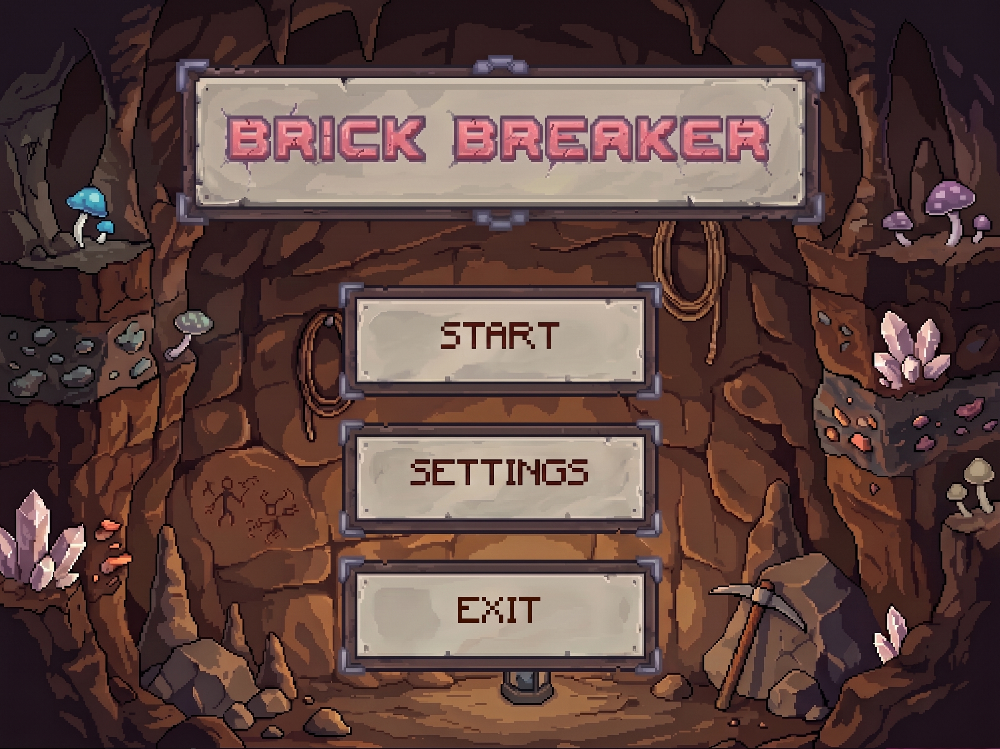
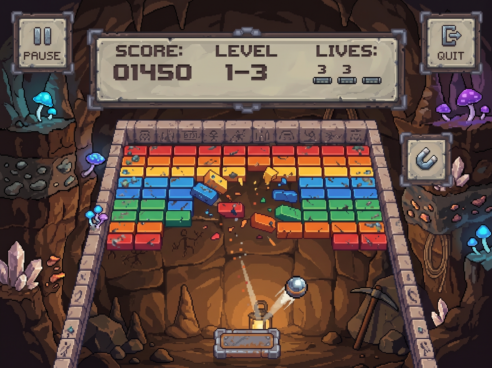
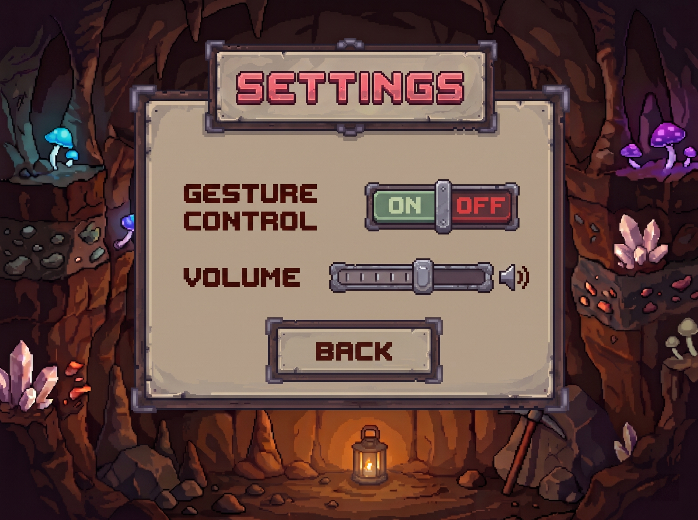

# 🧱 VisionBrick – Hand-Tracked Brick Breaker

<div align="center">

[](https://github.com/dngphuu/ptit-btl-python/releases)
[](https://python.org)
[](https://pyga.me)
[](https://developers.google.com/mediapipe)
[]()
[](LICENSE)

**VisionBrick** is an arcade 2D Brick Breaker game developed with **Python**, **pygame-ce**, and **Google MediaPipe Tasks API**. Experience fluid paddle control driven by real-time webcam hand tracking or classic keyboard inputs, immersed in a rich retro cave and hieroglyphic stone aesthetic.

[🎮 Game Previews](#-game-previews) • [✨ Features](#-features) • [🕹️ Controls](#-controls) • [🚀 Quick Start](#-local-development--quickstart) • [📦 Standalone Download](#-download-pre-built-binary-windows) • [📐 Architecture](#-system-architecture--how-it-works) • [🎓 Academic Context](#-thông-tin-dự-án)

</div>

---

## 🎓 Thông tin dự án

> **Học viện Công nghệ Bưu chính Viễn thông (PTIT)**  
> **Môn học:** Lập trình với Python (Python Programming)  
> **Đề tài:** *VisionBrick – Tích hợp Thị giác máy tính vào trò chơi Brick Breaker cổ điển*  
> **Sinh viên thực hiện:**
> - **Đặng Gia Phú** (B24DCKH100)
> - **Nguyễn Tiến Dũng** (B24DCKH038)

---

## 🎮 Game Previews

| Main Menu | Gameplay & Live Vision Feed | Settings Menu |
| :---: | :---: | :---: |
|  |  |  |

---

## ✨ Features

- 🖐️ **Real-Time Hand Tracking**: Steer your paddle with webcam gesture input powered by **Google MediaPipe Tasks API (`HandLandmarker`)**. Tracking focuses on landmark #5 (MCP joint) for intuitive, natural responsiveness.
- 📉 **Jitter-Free Filtering (EMA)**: Exponential Moving Average filter eliminates camera noise and trembling, yielding ultra-smooth paddle movement.
- 🧵 **Multi-Threaded Vision Engine**: Non-blocking camera capture runs on an isolated daemon worker thread (`queue.Queue(maxsize=1)`), maintaining an uncompromising **60 FPS** render loop.
- ⌨️ **Keyboard Fallback**: Seamlessly switch between hand tracking and classic keyboard controls (<kbd>←</kbd> / <kbd>→</kbd> or <kbd>A</kbd> / <kbd>D</kbd>) without interrupting the game.
- 🎨 **Retro Pixel-Art Graphics**: Custom cave hieroglyphic stone border, animated torches, dynamic ball trail, and multi-colored bricks with realistic crumbling debris particle effects.
- 🔊 **Dynamic Audio & SFX**: Retro chiptune background music and crunchy 8-bit sound effects for paddle bounces, brick fractures, victories, and game overs.
- ⚙️ **Interactive Stone Settings Menu**: Custom stone-plaque UI featuring an interactive volume slider, mute capabilities, and a tactile toggle switch for gesture control.
- 💾 **Persistent Settings & High Scores**: Automatically saves game configuration and records highest scores to disk (`settings.json`, `highscore.txt`).
- 🖥️ **Aspect Ratio Preserved Scalable Display**: Logical 800×600 canvas automatically scales cleanly with window resizing and Fullscreen mode (<kbd>F11</kbd> or <kbd>Alt</kbd>+<kbd>Enter</kbd>).

---

## 🕹️ Controls

| Action | Hand Gesture / Mouse | Keyboard Shortcut |
| :--- | :--- | :--- |
| **Move Paddle** | Move hand horizontally across webcam feed | <kbd>←</kbd> / <kbd>→</kbd> or <kbd>A</kbd> / <kbd>D</kbd> |
| **Pause / Resume** | Click **[PAUSE]** stone button | <kbd>P</kbd> |
| **Toggle Fullscreen** | — | <kbd>F11</kbd> or <kbd>Alt</kbd> + <kbd>Enter</kbd> |
| **Exit to Menu / Quit** | Click **[EXIT]** stone button | <kbd>Esc</kbd> |
| **Navigate Menus** | Mouse click & drag (sliders/buttons) | <kbd>Enter</kbd> / <kbd>Esc</kbd> |

---

## 📐 System Architecture & How It Works

VisionBrick is designed with a strict boundary between computer vision inference and game physics, preventing frame drops and isolating dependencies.

```mermaid
flowchart TD
    subgraph Vision Pipeline ["Thread 1: Camera & Vision Worker"]
        CAM["📷 Webcam (cv2.VideoCapture)"] -->|Frame Capture| PRE["Flip & Resize (640×480)"]
        PRE -->|RGB Image| MP["MediaPipe HandLandmarker"]
        MP -->|Extract Landmark #5 X-Coord| MAP["Coordinate Normalization [0.15, 0.85]"]
        MAP -->|Normalized Coord x ∈ [0, 1]| QUEUE["Thread Queue (maxsize=1)"]
    end

    subgraph Game Engine ["Thread 2: Pygame Main Render Loop (60 FPS)"]
        QUEUE -.->|Latest Coords| EMA["EMA Smoothing Filter\n(alpha = 0.30)"]
        KEY["⌨️ Keyboard Fallback (A/D, Arrows)"] -.->|Override| EMA
        EMA --> PADDLE["Update Paddle Position"]
        PADDLE --> PHYS["Ball Physics & AABB Collision"]
        PHYS --> GRID["Brick Grid & Particle Debris"]
        GRID --> RENDER["Render Scaled 800×600 Scene"]
    end
```

### 🔬 Mathematical Principles: EMA Smoothing Filter

To eliminate jitter caused by webcam noise and varying room lighting, coordinates are mapped from a normalized camera tracking zone $[X_{\min}, X_{\max}] = [0.15, 0.85]$ and filtered using an **Exponential Moving Average**:

$$X_t = \alpha \cdot X_{\text{raw}} + (1 - \alpha) \cdot X_{t-1}$$

* Where $\alpha = 0.30$ balances instant hand response with silky-smooth paddle motion.
* Hand positions outside the tracking zone are cleanly clamped to keep the paddle within the stone playfield.

---

## 📦 Download Pre-built Binary (Windows)

No Python installation or dependencies needed! You can download the portable standalone package:

1. Visit [**Releases**](https://github.com/dngphuu/ptit-btl-python/releases).
2. Download **`VisionBrick-v1.0.0-windows-x64.zip`**.
3. Extract the ZIP archive anywhere on your machine.
4. Launch **`VisionBrick.exe`** to play immediately!

---

## 🚀 Local Development & Quickstart

### Prerequisites
- **Python 3.10+**
- A standard **webcam** (for gesture tracking)
- Recommended: [`uv`](https://docs.astral.sh/uv/) (blazing-fast Python package manager)

### 1. Clone the repository
```bash
git clone https://github.com/dngphuu/ptit-btl-python.git
cd ptit-btl-python
```

### 2. Install dependencies

Using `uv` (recommended):
```bash
uv sync
```

Or using standard `pip`:
```bash
python -m venv .venv
# Windows:
.venv\Scripts\activate
# Linux/macOS:
source .venv/bin/activate

pip install -e .
pip install -e ".[dev]"
```

### 3. Run the game
```bash
uv run python main.py
# Or with standard python:
python main.py
```

### 4. Run tests and linting
```bash
# Run pytest test suite
uv run pytest

# Check code formatting & linting
uv run ruff check .
```

---

## 🔨 Building the Windows Standalone Executable

The project includes an automated PyInstaller packaging script (`build_windows.py`) that bundles all assets, fonts, sounds, and the MediaPipe model:

```bash
uv run python build_windows.py
```

The resulting files will be generated in `dist/`:
- Folder distribution: `dist/VisionBrick/VisionBrick.exe`
- Portable ZIP archive: `dist/VisionBrick-v1.0.0-windows-x64.zip`

---

## 📂 Project Structure

```
ptit-btl-python/
├── .github/workflows/         # CI/CD workflows (automated release build)
├── assets/                    # Audio, fonts, backgrounds, and sprite sheets
│   ├── audio/                 # BGM and SFX (.mp3, .ogg)
│   ├── backgrounds/           # Frame textures (menu & game frames)
│   ├── fonts/                 # TTF pixel fonts (Minecraft, ThaleahFat)
│   └── sprites/               # UI buttons, stone tiles, bricks
├── mockups/                   # Design previews and mockups
├── models/                    # MediaPipe hand_landmarker.task model
├── src/
│   ├── config.py              # Centralized configuration & constants
│   ├── core/                  # Audio manager, game states, settings persistence
│   ├── entities/              # Ball, Paddle, BrickGrid, Debris particles, Playfield
│   ├── filters/               # Exponential Moving Average (EMA) smoother
│   ├── screens/               # MainMenu, GameplayScreen, SettingsMenu
│   ├── ui/                    # UI button and interactive widgets
│   └── vision/                # OpenCV camera pipeline & MediaPipe input processor
├── tests/                     # Pytest unit tests
├── build_windows.py           # Automated PyInstaller build script
├── DE-XUAT-Y-TUONG.md         # Detailed project proposal (Vietnamese)
├── main.py                    # Game entry point & state machine loop
├── pyproject.toml             # Project metadata & dependencies
└── README.md                  # Project documentation
```

---

## 🔧 Tunable Configuration (`src/config.py`)

All core gameplay and vision parameters can be tuned in `src/config.py`:

| Parameter | Default | Description |
| :--- | :--- | :--- |
| `TARGET_FPS` | `60` | Target Pygame render loop frame rate |
| `CAMERA_TARGET_FPS` | `30` | Target camera capture frame rate |
| `EMA_ALPHA` | `0.30` | Smoothing factor (higher = faster response, lower = smoother) |
| `CAM_X_MIN`, `CAM_X_MAX` | `0.15`, `0.85` | Normalized camera interaction horizontal bounds |
| `PADDLE_WIDTH` | `100` | Width of the player paddle in pixels |
| `BRICK_GRID_COLS` | `10` | Number of brick columns |
| `BRICK_GRID_ROWS` | `9` | Number of brick rows |
| `HAND_LANDMARK_INDEX` | `5` | Tracking landmark (Index MCP joint) |

---

## ❓ Troubleshooting & FAQs

<details>
<summary><b>1. Camera feed is not appearing or paddle is not moving with hand gestures</b></summary>

- Ensure your webcam is connected and not currently in use by another application (Zoom, Teams, browser).
- Check the **Settings Menu** inside the game to verify that **Gesture Control** is toggled to **ON**.
- If you have multiple cameras, adjust `CAMERA_INDEX` in `src/config.py` (default is `0`).
- Ensure adequate lighting so that MediaPipe can clearly detect hand landmarks.
</details>

<details>
<summary><b>2. Game runs slowly or stutters</b></summary>

- VisionBrick utilizes CPU inference with MediaPipe's lightweight model. Ensure your system meets the minimum Python 3.10+ requirement.
- Running on battery power on some laptops may throttle CPU clocks; try plugging in or selecting a high-performance power plan.
</details>

<details>
<summary><b>3. Pygame audio warning or no sound</b></summary>

- Check that your default audio playback device is connected and active before launching the game.
- You can adjust or unmute the volume via the in-game **Settings** screen.
</details>

---

## 📜 License & Acknowledgments

- **License:** Distributed under the [MIT License](LICENSE).
- **Coursework:** Developed for the **Python Programming** course at **Posts and Telecommunications Institute of Technology (PTIT)**.
- **Libraries & Assets:**
  - [pygame-ce](https://pyga.me/) - Modern Community Edition Pygame library.
  - [Google MediaPipe](https://developers.google.com/mediapipe) - On-device machine learning solutions.
  - [OpenCV](https://opencv.org/) - Real-time computer vision library.
